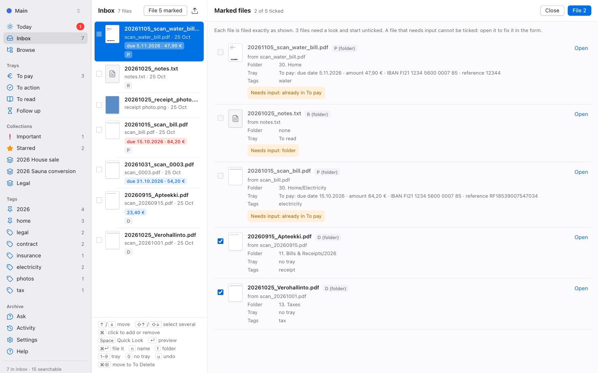

# Digital Archive Manager

[](https://github.com/KalastajaM/digital-archive-manager/actions/workflows/ci.yml)
[](LICENSE)


**Your paperwork, filed and findable.** Digital Archive Manager (`dam`) is a local-first
app for the documents you keep in Google Drive, OneDrive, Dropbox, iCloud Drive or any
plain folder. It reads every document (with OCR for scans), suggests a name and a folder
for each new one, keeps your bills and to-dos in trays, and lets you search everything,
without ever deleting a file.

<picture>
  <source media="(prefers-color-scheme: dark)" srcset="docs/images/inbox-dark.png">
  
</picture>

## Why you might like it

- **Safe by design.** dam never deletes your files. Every change is shown before it
  happens, recorded, and can be undone. "Delete" means moving to a `To Delete` folder that
  you empty yourself. Important files are locked against renaming and moving until you
  unlock them, and you can lock any file.
- **Decide on paper, file in one go.** Save a scan straight into the inbox's To pay or
  To action folder, or put a printed QR sticker on the paper before scanning (tick ★ or
  ! on it to star it or mark it Important). dam fills in the tray, folder and tags from
  that, and **File N marked** files the whole batch after one look, with one Undo.
- **Your folders, your cloud.** It works on an ordinary folder that your sync client
  already keeps in sync, so there is no new account, no upload and no lock-in. Stop using
  dam and your archive is still just folders and files.
- **Private.** Everything runs on your computer; the app only listens on `127.0.0.1`.
  The optional AI help sends text only when you click, after showing you exactly what will
  be sent, and never from the folders you exclude (by default medical, work and other people's
  documents; change the list under Activity → AI).
- **Fast filing.** New documents land in an inbox. dam reads them, proposes a name, a
  folder (from your rules, or from where similar files went) and tags, and files them with
  one key.
- **Bills that pay themselves (almost).** Due dates, amounts, IBANs and references are
  picked up from the scan. The To pay tray shows what is due, with a copy button on every
  field, and for Finnish bills a bank barcode to scan with your banking app.
- **Collections for things in progress.** Group the documents of a house sale, a
  renovation or a court case, with notes and a checklist, without moving them. Add a whole
  folder and everything in it belongs, including what you put in it later.

<table>
  <tr>
    <td><picture><source media="(prefers-color-scheme: dark)" srcset="docs/images/today-dark.png"></picture></td>
    <td><picture><source media="(prefers-color-scheme: dark)" srcset="docs/images/paymode-dark.png"></picture></td>
  </tr>
  <tr>
    <td align="center"><b>Today</b>: what needs you, at a glance</td>
    <td align="center"><b>Pay mode</b>: check the details, scan, done</td>
  </tr>
  <tr>
    <td><picture><source media="(prefers-color-scheme: dark)" srcset="docs/images/browse-dark.png"></picture></td>
    <td><picture><source media="(prefers-color-scheme: dark)" srcset="docs/images/activity-dark.png"></picture></td>
  </tr>
  <tr>
    <td align="center"><b>Browse</b>: folders, full-text search, Quick Look</td>
    <td align="center"><b>Activity</b>: every change, each with Undo</td>
  </tr>
  <tr>
    <td><picture><source media="(prefers-color-scheme: dark)" srcset="docs/images/collection-dark.png"></picture></td>
    <td><picture><source media="(prefers-color-scheme: dark)" srcset="docs/images/ai-settings-dark.png"></picture></td>
  </tr>
  <tr>
    <td align="center"><b>Collections</b>: a house sale in one place, nothing moved</td>
    <td align="center"><b>AI settings</b>: spend, the switch and the folders never sent</td>
  </tr>
  <tr>
    <td><picture><source media="(prefers-color-scheme: dark)" srcset="docs/images/filing-codes-dark.png"></picture></td>
    <td><picture></picture></td>
  </tr>
  <tr>
    <td align="center"><b>File N marked</b>: a whole batch, checked and filed at once</td>
    <td align="center"><b>QR stickers</b>: decide on the paper before you scan</td>
  </tr>
</table>

## Quick start

You need [uv](https://docs.astral.sh/uv/) and [Node.js](https://nodejs.org/) 22 or newer.

```sh
git clone https://github.com/KalastajaM/digital-archive-manager.git
cd digital-archive-manager
cd backend && uv sync
cd ../frontend && npm ci && npm run build
cd ../backend && uv run dam serve
```

The same commands work in PowerShell on Windows. `dam serve` opens the app in your
browser at `http://127.0.0.1:8765`; you can install it as its own app window from Chrome
or Safari.

On first start dam asks which folder is your archive. It finds the folders of Google
Drive, OneDrive, Dropbox, iCloud Drive, Nextcloud and others for you, or you pick any
folder. Then either:

- **use an existing archive as it is**: dam indexes it and changes nothing until you ask, or
- **start a new archive**: pick a starter layout (Household, Minimal or your own),
  preview the folders, and create them (undoable, like everything else).

**Just want to look around first?** Create a demo archive with made-up documents:

```sh
cd backend
uv run dam archives add Demo --demo --folder /tmp/dam-demo-archive
uv run dam --archive Demo serve --port 8766
```

You can keep several archives (say your real one and a test one), each with its own
settings, and switch between them from the top of the sidebar.

## Platform support

| | macOS | Windows | Linux |
|---|:-:|:-:|:-:|
| Index, search, file, undo, trays, collections, export | ✓ | ✓ | ✓ |
| OCR of scans and photos | ✓ Apple Vision | ✓ with [Tesseract](https://github.com/UB-Mannheim/tesseract/wiki) | ✓ with Tesseract |
| Quick Look thumbnails of any file type | ✓ | PDFs and images | PDFs and images |
| Desktop notifications, daily reminder job | ✓ | e-mail only for now | e-mail only for now |
| Collection links in the `Ongoing` folder | ✓ | needs Developer Mode | ✓ |

Details are in the [technical reference](docs/reference.md#platform-support).

## Documentation

- [User guide](docs/guide.md): how dam works, every screen, keyboard shortcuts, trays,
  collections, reminders, the optional AI and what dam never does (also under Help in
  the app)
- [Technical reference](docs/reference.md): install, the command line, config files and
  rules, the API and the safety model in detail
- [Changelog](CHANGELOG.md)
- [Contributing](CONTRIBUTING.md): development setup, tests and the safety rules every
  change must keep
- [Security policy](SECURITY.md)

## License

[MIT](LICENSE) © KalastajaM. The optional Outlook `.msg` support (`dam[msg]`) uses
[extract-msg](https://github.com/TeamMsgExtractor/msg-extractor), which is GPL-licensed
and not included in the core install; see [licensing](docs/licensing.md).
