# Digital Archive Manager

[](https://github.com/KalastajaM/digital-archive-manager/actions/workflows/ci.yml)
[](LICENSE)


**Your paperwork, filed and findable.** Digital Archive Manager (`dam`) is a local-first
app for the documents you keep in Google Drive, OneDrive, Dropbox, iCloud Drive or any
plain folder. It reads every document (with OCR for scans), suggests a name and a folder
for each new one, keeps your bills and to-dos in trays, and lets you search everything,
without ever deleting a file.

<picture>
  <source media="(prefers-color-scheme: dark)" srcset="docs/images/inbox-dark.png">
  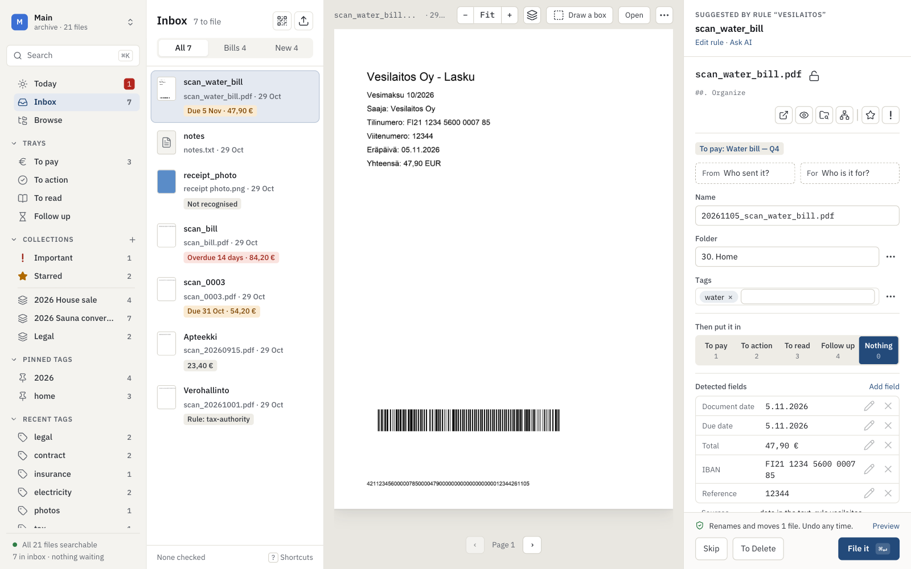
</picture>

## Why you might like it

- **Safe by design.** dam never deletes your files. Every change is shown before it
  happens, recorded, and can be undone. "Delete" means moving to a `To Delete` folder that
  you empty yourself. Important files are locked against renaming and moving until you
  unlock them, and you can lock any file.
- **Decide on paper, file in one go.** Save a scan straight into the inbox's To pay or
  To action folder, or put a printed QR sticker on the paper before scanning (tick ★ or
  ! on it to star it or mark it Important). dam fills in the tray, folder and tags from
  that, and **File N marked** files the whole batch after one look, with one Undo.
- **Your folders, your cloud.** It works on an ordinary folder that your sync client
  already keeps in sync, so there is no new account, no upload and no lock-in. Stop using
  dam and your archive is still just folders and files.
- **Private.** Everything runs on your computer; the app only listens on `127.0.0.1`.
  The optional AI help sends text only when you click, after showing you exactly what will
  be sent, and never from the folders you exclude (by default medical, work and other people's
  documents; change the list under Activity → AI).
- **Fast filing.** New documents land in an inbox. dam reads them, proposes a name, a
  folder (from your rules, or from where similar files went) and tags, and files them with
  one key. Rules are drafted from how you file and proven against the documents you filed
  before you save them. A rule can match words or a picture, such as a logo, in an area of
  page 1, and can file per person, since the address area tells who a letter is for.
- **Bills that pay themselves (almost).** Due dates, amounts, IBANs and references are
  picked up from the scan. The To pay tray shows what is due, with a copy button on every
  field, and for Finnish bills a bank barcode to scan with your banking app.
- **Collections for things in progress.** Group the documents of a house sale, a
  renovation or a court case, with notes and a checklist, without moving them. Add a whole
  folder and everything in it belongs, including what you put in it later.
- **Tags and search.** Search by tag from the Search card on Today or in Browse. A Tags
  screen lets you rename, merge and group tags, each change with Undo.
- **Relatives: a family tree for each document.** Every document shows the files it
  belongs with, and why: the same sender, reference number, IBAN, collection, tag, folder or
  person. Last year's bill, the contract behind it and the scan still in the inbox show up
  together; open the connections view to see them by folder, compare one side by side in
  Quick Look, and tag, collect, move or link them together in one undoable step. Built only
  from what you stored; an optional AI pass finds more, on a click.

<table>
  <tr>
    <td><picture><source media="(prefers-color-scheme: dark)" srcset="docs/images/relatives-dark.png">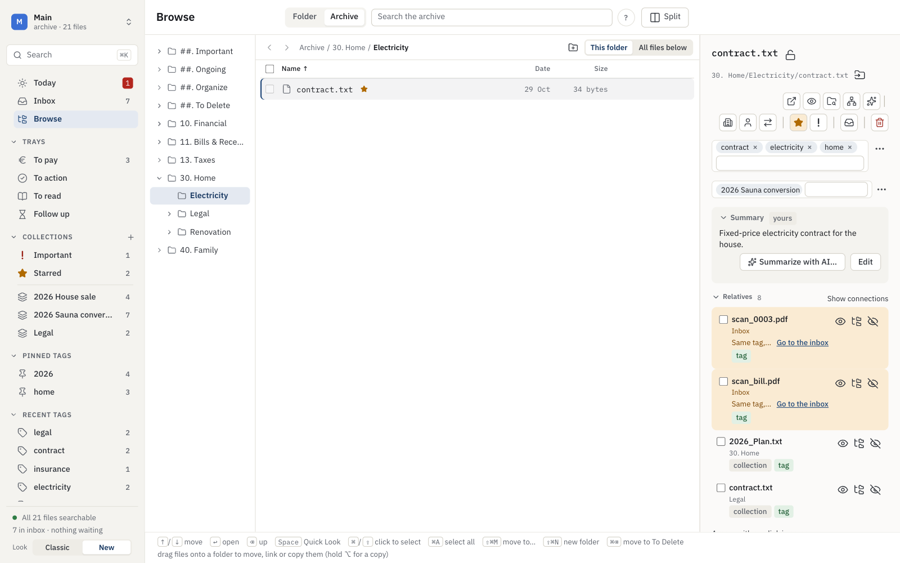</picture></td>
    <td><picture><source media="(prefers-color-scheme: dark)" srcset="docs/images/connections-dark.png">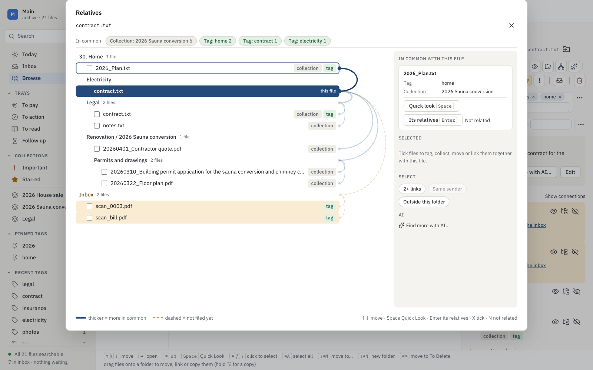</picture></td>
  </tr>
  <tr>
    <td align="center"><b>Relatives</b>: the files a document belongs with, and why</td>
    <td align="center"><b>Show connections</b>: the whole family by folder</td>
  </tr>
  <tr>
    <td><picture><source media="(prefers-color-scheme: dark)" srcset="docs/images/today-dark.png">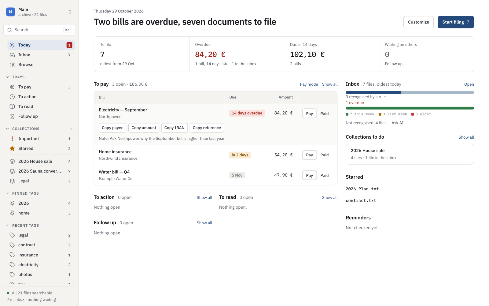</picture></td>
    <td><picture><source media="(prefers-color-scheme: dark)" srcset="docs/images/paymode-dark.png">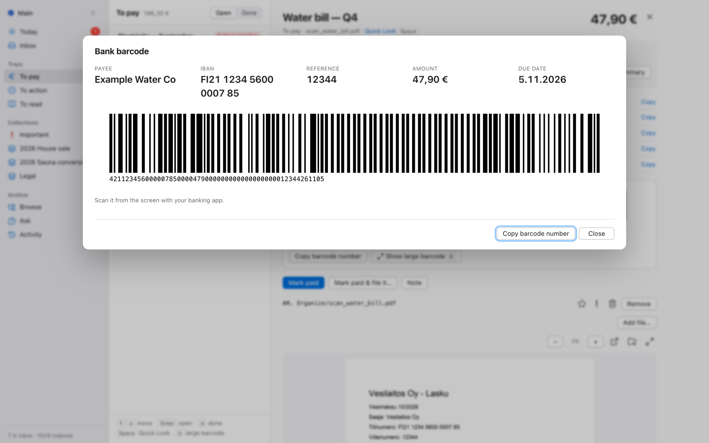</picture></td>
  </tr>
  <tr>
    <td align="center"><b>Today</b>: what needs you, at a glance</td>
    <td align="center"><b>Pay mode</b>: check the details, scan, done</td>
  </tr>
  <tr>
    <td><picture><source media="(prefers-color-scheme: dark)" srcset="docs/images/browse-dark.png">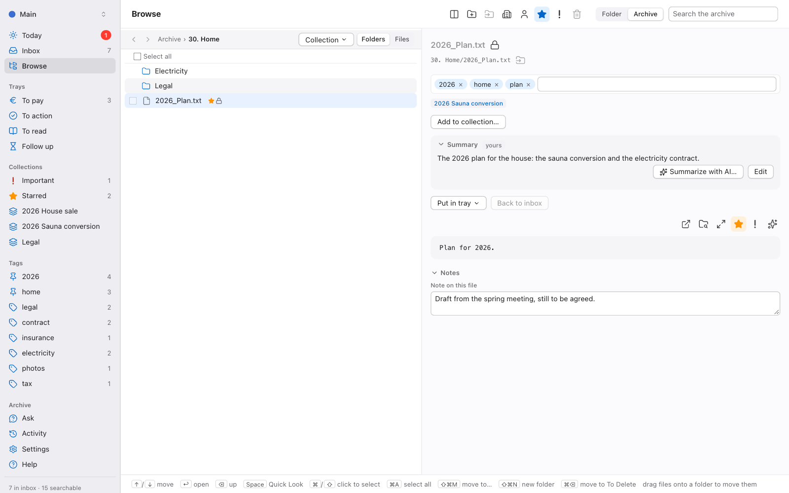</picture></td>
    <td><picture><source media="(prefers-color-scheme: dark)" srcset="docs/images/activity-dark.png">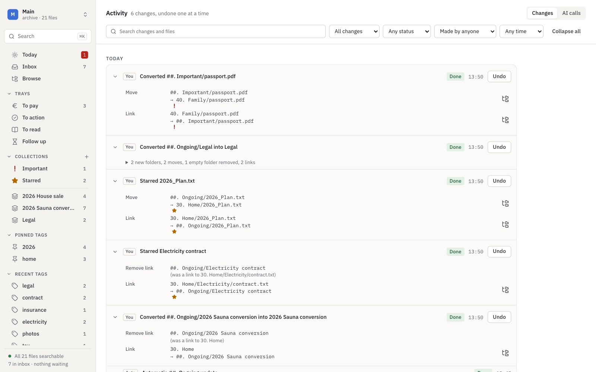</picture></td>
  </tr>
  <tr>
    <td align="center"><b>Browse</b>: folders, tags, summaries, Quick Look</td>
    <td align="center"><b>Activity</b>: every change, each with Undo</td>
  </tr>
  <tr>
    <td><picture><source media="(prefers-color-scheme: dark)" srcset="docs/images/collection-dark.png">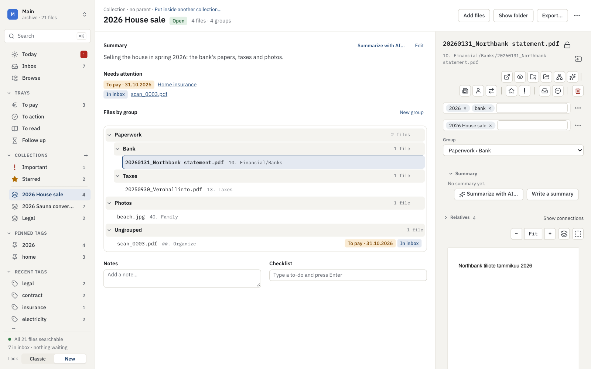</picture></td>
    <td><picture><source media="(prefers-color-scheme: dark)" srcset="docs/images/tags-dark.png">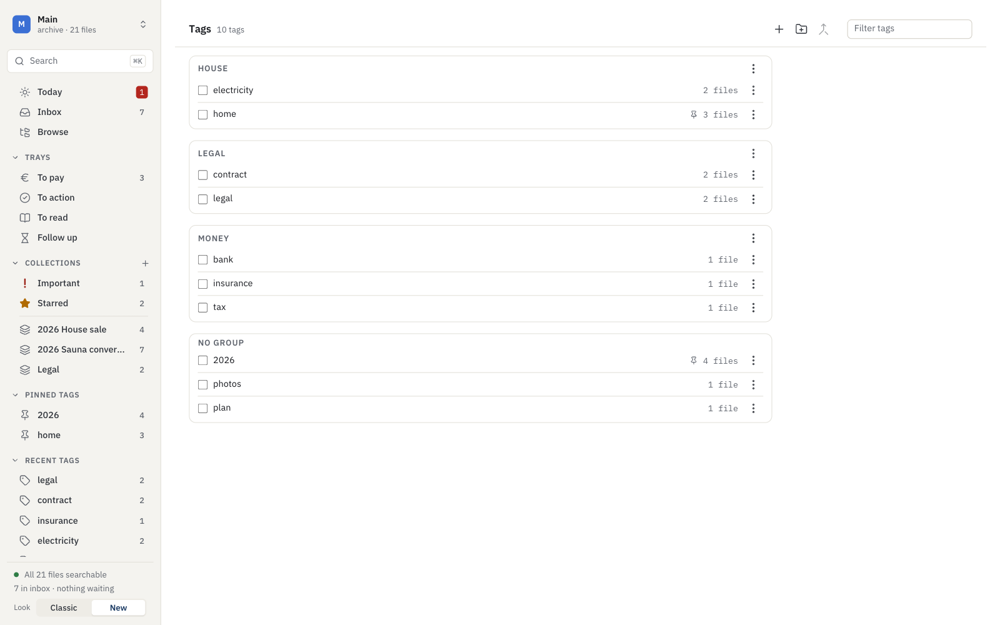</picture></td>
  </tr>
  <tr>
    <td align="center"><b>Collections</b>: a house sale in one place, nothing moved</td>
    <td align="center"><b>Tags</b>: rename, merge, group and pin, each with Undo</td>
  </tr>
  <tr>
    <td><picture><source media="(prefers-color-scheme: dark)" srcset="docs/images/boxes-dark.png">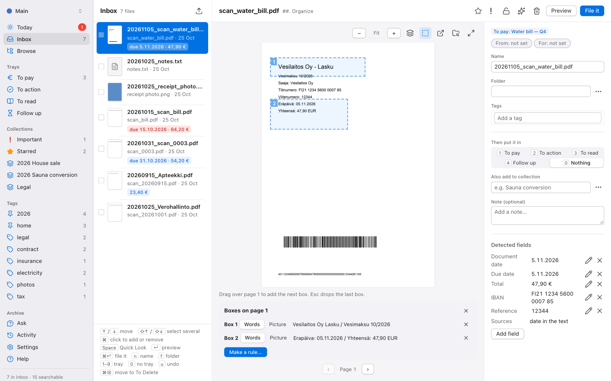</picture></td>
    <td><picture><source media="(prefers-color-scheme: dark)" srcset="docs/images/rule-sheet-dark.png">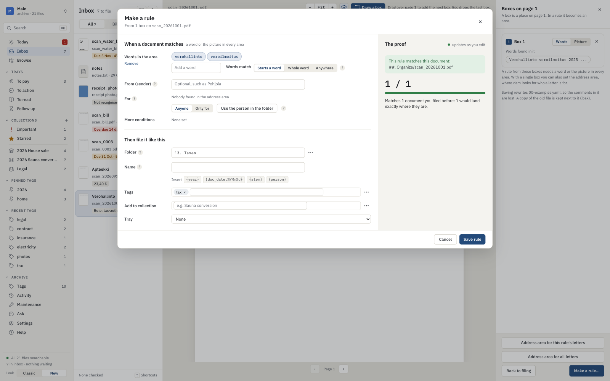</picture></td>
  </tr>
  <tr>
    <td align="center"><b>Boxes on page 1</b>: draw over a letterhead to start a rule</td>
    <td align="center"><b>Rule sheet</b>: proven against your filed documents first</td>
  </tr>
  <tr>
    <td><picture>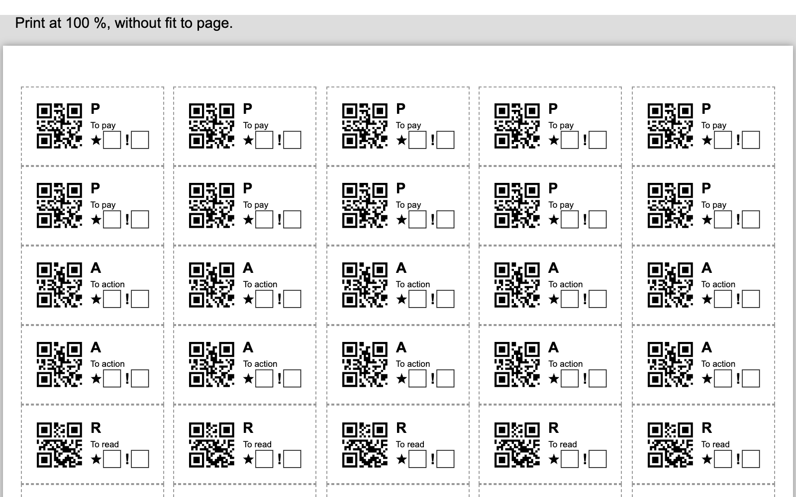</picture></td>
    <td><picture><source media="(prefers-color-scheme: dark)" srcset="docs/images/ai-settings-dark.png">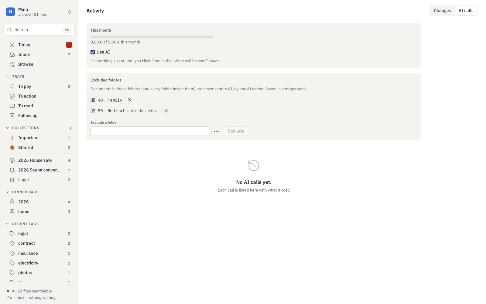</picture></td>
  </tr>
  <tr>
    <td align="center"><b>QR stickers</b>: decide on the paper before you scan</td>
    <td align="center"><b>AI settings</b>: spend, the switch and the folders never sent</td>
  </tr>
</table>

The screenshots show the New look, which dam opens in. The earlier Classic look is still in
Settings, Appearance, for now (Relatives are in the New look only).

## Quick start

You need [uv](https://docs.astral.sh/uv/) and [Node.js](https://nodejs.org/) 22 or newer.

```sh
git clone https://github.com/KalastajaM/digital-archive-manager.git
cd digital-archive-manager
cd backend && uv sync
cd ../frontend && npm ci && npm run build
cd ../backend && uv run dam serve
```

The same commands work in PowerShell on Windows. `dam serve` opens the app in your
browser at `http://127.0.0.1:8765`; you can install it as its own app window from Chrome
or Safari.

On first start dam asks which folder is your archive. It finds the folders of Google
Drive, OneDrive, Dropbox, iCloud Drive, Nextcloud and others for you, or you pick any
folder. Then either:

- **use an existing archive as it is**: dam indexes it and changes nothing until you ask, or
- **start a new archive**: pick a starter layout (Household, Minimal or your own),
  preview the folders, and create them (undoable, like everything else).

**Just want to look around first?** Create a demo archive with made-up documents:

```sh
cd backend
uv run dam archives add Demo --demo --folder /tmp/dam-demo-archive
uv run dam --archive Demo serve --port 8766
```

You can keep several archives (say your real one and a test one), each with its own
settings, and switch between them from the top of the sidebar.

## Platform support

| | macOS | Windows | Linux |
|---|:-:|:-:|:-:|
| Index, search, file, undo, trays, collections, export | ✓ | ✓ | ✓ |
| OCR of scans and photos | ✓ Apple Vision | ✓ with [Tesseract](https://github.com/UB-Mannheim/tesseract/wiki) | ✓ with Tesseract |
| Quick Look thumbnails of any file type | ✓ | PDFs and images | PDFs and images |
| Desktop notifications, daily reminder job | ✓ | e-mail only for now | e-mail only for now |
| Collection links in the `Ongoing` folder, and **Link** when dropping files | ✓ | needs Developer Mode | ✓ |

Details are in the [technical reference](docs/reference.md#platform-support).

## Countries and languages

dam was built for Finnish post, and some of what it reads from a document belongs to one
country or one language:

| | Today |
|---|---|
| Bank barcode on bills (pankkiviivakoodi) | Finland |
| Payment reference numbers | RF (international) and the Finnish viitenumero |
| IBAN | Finnish accounts |
| Where the address sits on page 1 of a letter | the Finnish letter standard (SFS 2487); you can draw your own |
| Due-date and total labels on bills | Finnish, Swedish and English |
| OCR | the languages you set in `ocr_languages` |

The reference numbers, the address area and the label words are kept in **country
packs** and **language packs**, the start of support for other countries. Still to come:
choosing the packs in Settings, IBANs and bank barcodes in packs too, and a Netherlands
pack. If you would like
your country supported, open an issue with a few example bills and letters (with personal
details removed), or see [Contributing](CONTRIBUTING.md).

## Documentation

- [User guide](docs/guide.md): how dam works, every screen, keyboard shortcuts, trays,
  collections, reminders, the optional AI and what dam never does (also under Help in
  the app)
- [Technical reference](docs/reference.md): install, the command line, config files and
  rules, the API and the safety model in detail
- [Changelog](CHANGELOG.md)
- [Contributing](CONTRIBUTING.md): development setup, tests and the safety rules every
  change must keep
- [Security policy](SECURITY.md)

## License

[MIT](LICENSE) © KalastajaM. The optional Outlook `.msg` support (`dam[msg]`) uses
[extract-msg](https://github.com/TeamMsgExtractor/msg-extractor), which is GPL-licensed
and not included in the core install; see [licensing](docs/licensing.md).
